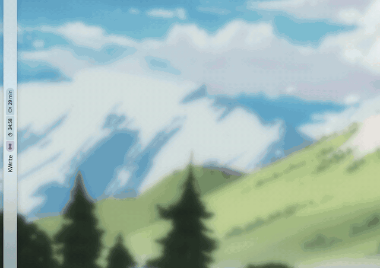
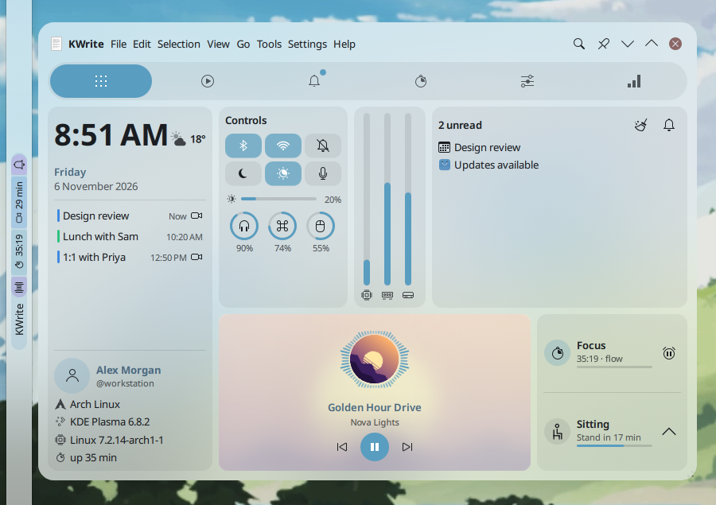
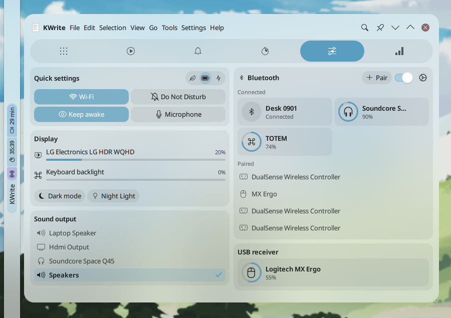
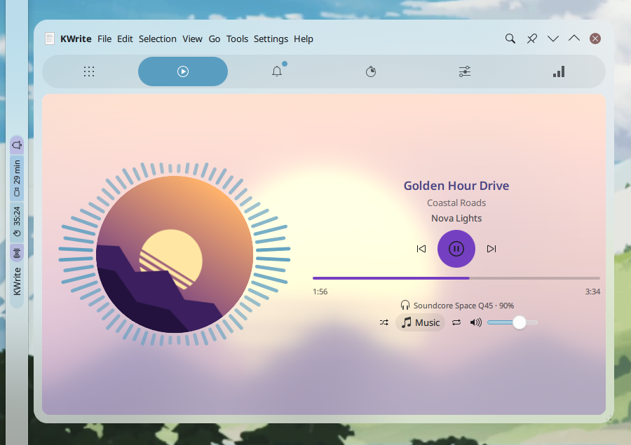
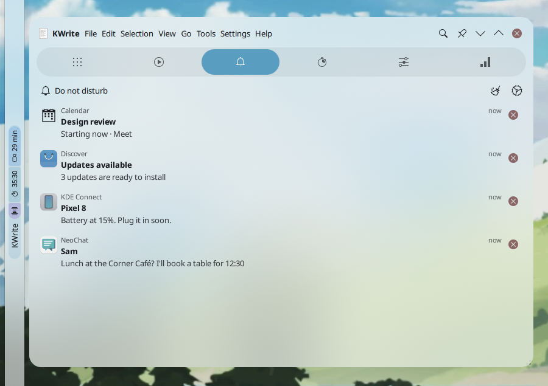
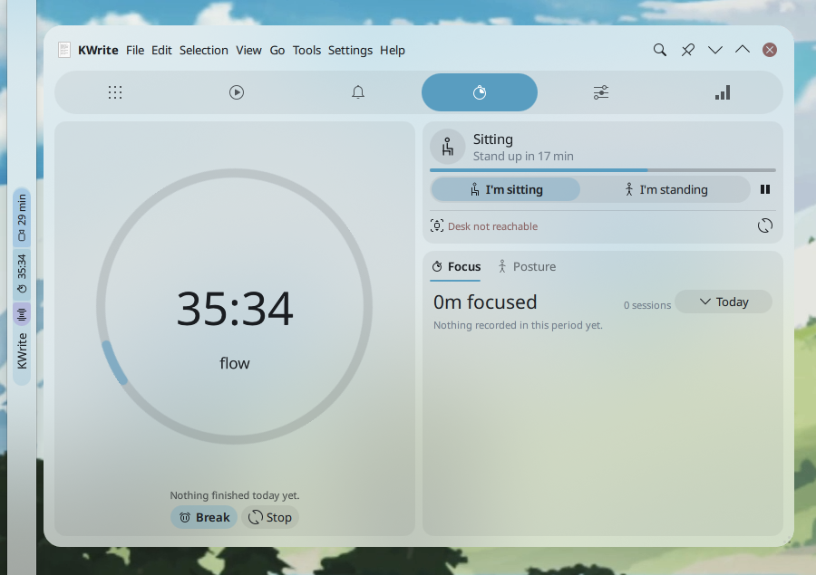
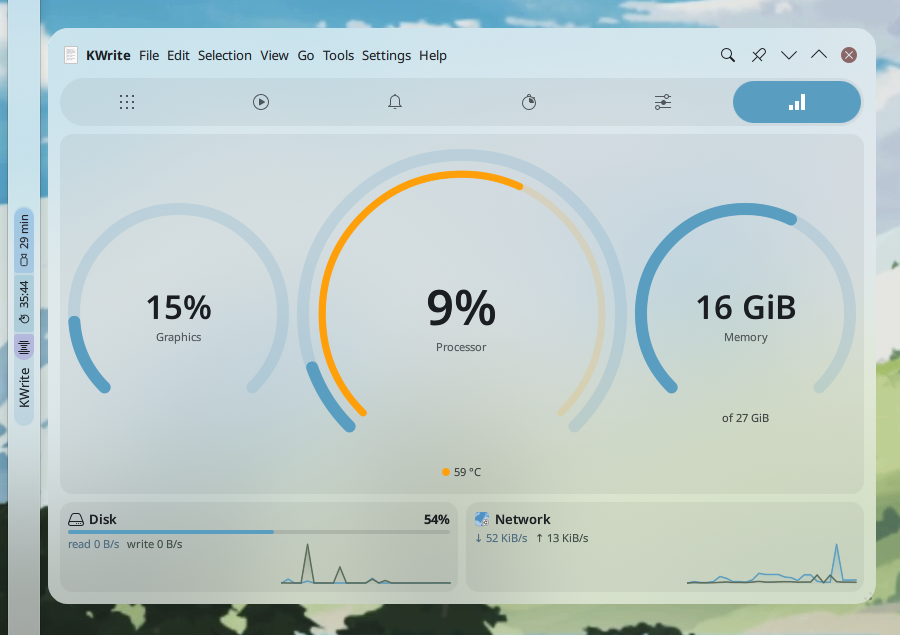
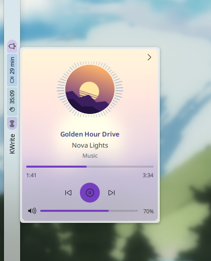
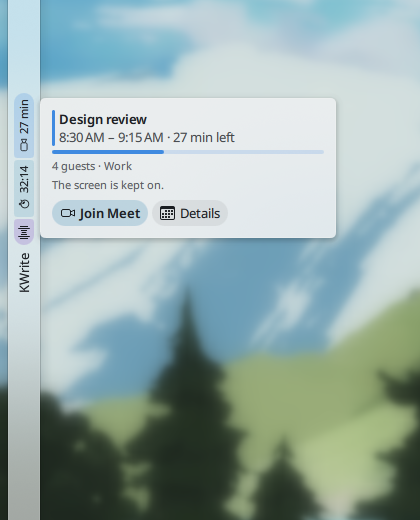
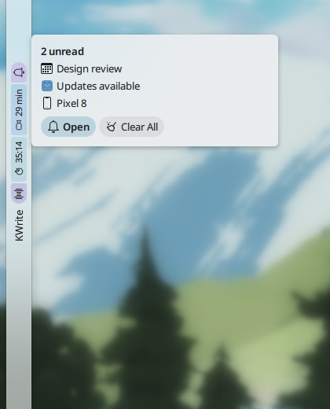

# Glance for Plasma 6

[](https://github.com/divinae/glance-plasmoid/releases/latest)
[](#license)
[](https://ko-fi.com/divinae4535)

**Everything at a glance, from a vertical panel.** The active window and its menus, what's
playing, your notifications and today's meetings, quick controls, the system's load, a focus
timer and sit/stand reminders: in a strip along the panel, with status pills as macOS shows them
in its menu bar, and a drawer that slides out of it.



### Why you'll like it

- 📏 **Made for a vertical panel.** The strip runs along it and says one thing at a time; the
  drawer slides out beside it, translucent over a blurred background.
- 💊 **Status at a glance.** Pills for the music, the camera, microphone and screen sharing in
  use, file transfers, the focus timer, the meeting on now, unread notifications and a battery
  running low. Hover one for its card: seek and volume, Join, Pause and Cancel.
- 🍎 **The window's menus, as on macOS.** The global menu in the drawer's menu bar, searchable in
  a few letters ("prof new" finds File › New Tab › Profile…), Alt+letter, the app's About and
  Quit, the window's buttons.
- 🎵 **Music that looks the part.** The cover in the spectrum's rays, the controls in a colour
  from the album, bars to the beat in the pill (with `cava`).
- 🎥 **Meetings on time.** With Event Calendar NG: "Standup in 5 min" in the strip, a pill with
  the time left while it's on, Join in one click, the screen kept awake, no focus break in the
  middle of a call.
- 🎛️ **Controls in one place.** Wi-Fi, Bluetooth and its devices, Do Not Disturb, keep awake, the
  microphone, the power profile, brightness, dark mode, Night Light and where sound goes.
- 🍅 **Focus and a standing desk.** A pomodoro or flowmodoro timer with a break overlay, and
  sit/stand reminders that can move a motorized desk (idasen or any command line tool).
- 🔒 **No servers, no tracking.** Glance talks to Plasma and to your apps over D-Bus; the only
  thing it loads from the network is a cover a player points to. What it keeps is your focus and
  standing stats, on your machine.

## Screenshots

All shots (and the animation above) use made-up data, from `tools/screenshots.sh`.

<details>
<summary><b>Each tab and the pills' cards</b></summary>

| | |
| --- | --- |
|  |  |
| The dashboard | The Controls tab |
|  |  |
| The Media tab | Notifications |
|  |  |
| Focus and the standing desk | The System tab |

| | | |
| --- | --- | --- |
|  |  |  |
| The music pill's card | A meeting on now | Unread notifications |

</details>

## What it does

### In the panel

The strip shows one thing at a time, the first that applies:

1. a notice (a notification's summary, briefly);
2. the desk moving ("Moving the desk to standing…", or "Connecting to the desk… (try 3)");
3. time to sit down or stand up;
4. a meeting coming up: "Standup in 5 min";
5. what's playing, with a small equalizer from `cava`;
6. the next event, shortly before it;
7. the active window's name.

After it, status pills in one capsule, as macOS shows them in its menu bar. Only those that apply
show, and which may show at all is up to you:

| Pill | Shows | A click |
| --- | --- | --- |
| Music (the album's colour) | thin bars to the music; paused: resting bars and a pause badge | plays or pauses |
| Camera (green) | it's in use, and by whom | — |
| Microphone (orange) | it's in use | mutes what's being recorded |
| Screen sharing (red) | it's shared | ends it (through the portal) |
| File transfers (blue) | a wedge filling up, "42%" | opens the notifications |
| Focus | a wedge emptying, the time left; paused: the wedge or a stopwatch with a pause badge | starts or pauses |
| Meeting on now | the time left in it, "20 min" | opens it in Event Calendar (joins without it) |
| Sit/stand (amber) | a switch is due | switches |
| Unread (purple) | notifications you haven't seen | opens them |
| Do Not Disturb (grey) | how long it lasts | turns it off |

**Hover cards.** Hover the music pill for the track, the seek and volume sliders and the
controls. Hover the Focus, meeting, transfers, sit/stand or unread pill and a card opens
beside it, without the drawer: what's left and today's total with Start, Pause, Skip and Stop;
the meeting's times and guests with Join and Details; each transfer with Pause and Cancel;
Move the desk (or Done) and Snooze; the latest notifications with Open and Clear All.

Middle-click on the strip plays or pauses, the wheel skips tracks.

### The drawer

Hover the strip or click it, and a drawer slides out of the panel beside it, translucent over
a blurred background, rounded where it meets the panel's edge (or floating off a floating
panel). It resizes from its corner. Without `layer-shell-qt`, or if you prefer, Glance opens
Plasma's usual popup instead (Settings > Popup > Style).

**The window's menu bar** runs across its top, as on macOS:
- the app's icon: KWin's window menu (desktops, activities, keep above…), as Alt+F3;
- the app's name: its own About, Settings and Quit, found in its menus;
- its menus (the global menu), and Alt and a letter opens one by its mnemonic;
- 🔍 search them, as the old HUD: a few letters of any item however deep ("prof new" finds
  File › New Tab › Profile…), Enter runs it, ← goes back to the menus;
- the window's buttons: keep above, minimize, maximize, close.

**Its tabs:**
- **Dashboard:** the time and weather; today's events, one slim line each, with Join on
  meetings and tomorrow's first, faint, when today's are done; CPU, memory and disk; what's
  playing, over its blurred cover (with a player); who you are and what you run; your
  notifications; quick controls (Bluetooth, Wi-Fi, Do Not Disturb, dark mode, Night Light, the
  microphone, the brightness, the batteries); focus and posture; the shelf.
- **Media:** the cover inside the spectrum's rays and blurred behind it all, the controls in a
  colour from the cover, the seek bar (scroll for 5 s, tap the length for the time left), the
  volume (scroll on the cover), shuffle, repeat, and the player when there's more than one.
- **Notifications:** the history grouped by app, with actions, replies, thumbnails and file
  transfers; Do Not Disturb for an hour, four hours, until tomorrow…
- **Controls:** Wi-Fi, Do Not Disturb, keep awake, the microphone and the power profile; each
  screen's brightness, the keyboard's light, dark mode and Night Light; where sound goes;
  Bluetooth with its devices and Pair; the batteries of devices on a USB receiver.
- **Shelf:** drop files to keep them at hand, drag them out into any app.
- **Work** (Focus and Shift together, or each alone): the timer and its stats, where you are
  and what's next, today against your goal, the week, the desk.
- **System:** processor, graphics, memory, disk and network.

### Focus and Shift

Both are off until turned on in their settings. They take over from the separate
[Fokus](https://github.com/divinae/focus-plasmoid) and
[Shift](https://github.com/divinae/shift-plasmoid) widgets (their settings aren't imported).

- **Focus:** a pomodoro or flowmodoro timer, a break overlay on every screen, Do Not Disturb
  while you focus, media paused for breaks, sounds and scripts. Locking the screen pauses a
  session. "Start the timer when Plasma starts" means after a reboot: a timer you stopped stays
  stopped through a Plasma restart.
- **Shift:** sit/stand reminders and a motorized desk (idasen by default, any command line
  tool) that moves when you click, or by itself if you want.
- **Together:** Shift waits for your focus breaks, so there's no reminder or desk move in the
  middle of a session, and a switch that's nearly due is made at the break. Breaks count as
  neither sitting nor standing.
- **Keep the screen on:** while focusing, its breaks too, and during meetings; no dimming,
  screen lock or sleep. Two settings, both on.

### Meetings and events

Events and the weather come from the [Event Calendar NG](https://github.com/divinae/plasma-applet-eventcalendar)
widget, 1.21 or later, with "Share events with Glance" on there. They come over D-Bus, with
meeting links, within seconds of Plasma starting. Before a meeting, its name takes the panel
text; while it's on, its pill shows the time left.

- **Focus** goes on through a meeting, but no break starts during it: a session that ends
  meanwhile waits, and its break begins as the meeting ends ("No break during meetings").
- **Shift** waits until the meeting is over, and can stand you up for it.
- **"Mark as Ended"** in Event Calendar ends it in Glance too.
- **A click on an event** opens it in Event Calendar.

## Keys

| Where | Keys | Do |
| --- | --- | --- |
| The drawer | Esc | closes it |
| | Ctrl+F, Alt+/ | search the window's menus |
| | Alt+letter | open that menu |
| The search | ↑ ↓, Enter, Esc | pick, run, back to the menus |
| The Media tab | Space or K | play or pause |
| | P, N | previous, next |
| | J, L or ←, → | 5 s back, on |
| | Home, End, 0–9 | start, end, a tenth of the way in |

The keys work while the drawer has the keyboard (opened with a click).

## Requirements

Plasma 6 (tested on 6.8) with plasma-pa, `layer-shell-qt` for the drawer, PipeWire, and
optionally `cava` for the audio bars.

Build: CMake, extra-cmake-modules, Qt 6 (Quick, DBus, Widgets, Concurrent), KF6 WindowSystem and
Service, libplasma (with PlasmaQuick), libpipewire, gettext.

At run time, for what uses them: [Event Calendar NG](https://github.com/divinae/plasma-applet-eventcalendar)
1.21 or later for events and meetings, `kde-inhibit` (Plasma's) to keep the screen on, and
`gdbus` (GLib's) for KWin's window menu. The Controls tab uses Plasma's own modules: bluez-qt
and bluedevil for Bluetooth, plasma-nm for Wi-Fi, power-profiles-daemon for the power profile;
without one, only its control is missing.

## Install

Glance comes with a small QML plugin (`com.dv.glance.private`, C++), so it's built from source.
A `.plasmoid` alone (from a release or "Get New Widgets") has the QML only and won't load
without it.

**1. The build tools and libraries.** On Arch:

```sh
sudo pacman -S --needed base-devel cmake extra-cmake-modules qt6-base qt6-declarative \
    kwindowsystem kservice libplasma libpipewire gettext layer-shell-qt
sudo pacman -S --needed cava   # optional: the audio bars
```

Elsewhere, the same under your distribution's names (the list is under
[Requirements](#requirements)).

**2. Build and install** (to `~/.local`, no root):

```sh
git clone https://github.com/divinae/glance-plasmoid.git
cd glance-plasmoid
make install
```

Or download the source of the [latest release](https://github.com/divinae/glance-plasmoid/releases/latest)
and run `make install` in it.

**3. Once: let Plasma find the plugin** in `~/.local/lib/qml`, then log out and back in:

```sh
mkdir -p ~/.config/plasma-workspace/env
echo 'export QML_IMPORT_PATH="$HOME/.local/lib/qml${QML_IMPORT_PATH:+:$QML_IMPORT_PATH}"' \
    > ~/.config/plasma-workspace/env/glance.sh
```

**4. Add Glance** to a vertical panel: right click the panel > Add or Manage Widgets.

**Update:** `git pull && make install && make restart` (`make restart` restarts plasmashell).
**Uninstall:** `make uninstall`, and remove `~/.config/plasma-workspace/env/glance.sh`.

## Global menu

While "Application menu" is on, Glance owns the D-Bus name `org.kde.kappmenuview`, like the
stock Global Menu widget: applications that support it export their menus and hide their own
menu bars. Turn the option off to get in-window menu bars back.

## When something's off

- **No events:** turn on "Share events with Glance" in Event Calendar's settings (General). See what
  arrived with `qdbus6 com.dv.glance /Calendar Snapshot`. Without the link, Glance reads Event
  Calendar's cache (Google calendars only).
- **Apps' own menu bars are gone:** that's the global menu (see above). Turn "Application menu"
  off in Glance's settings, then restart the app.
- **"Module com.dv.glance.private is not installed":** Plasma doesn't find the plugin; see step 3
  of [Install](#install), then log out and back in.
- **No drawer, only Plasma's popup:** install `layer-shell-qt`.
- **A widget shortcut:** Glance's (Settings > Keyboard Shortcuts) opens and closes the drawer.

## Support

Glance is free and made in spare time. If it's useful to you, you can buy me a coffee on
[Ko-fi](https://ko-fi.com/divinae4535).

## Bugs and ideas

Report them in [GitHub Issues](https://github.com/divinae/glance-plasmoid/issues): your
distribution, the Plasma version, Glance's version, and for a problem the log below.

**Glance's log** (something doesn't work, the widget doesn't load): do what goes wrong, then
right after

```sh
journalctl --user -b --since "-15min" | grep -i -E "glance|plasmashell" > glance.log
```

and attach `glance.log`. Look it over before posting: it may name your windows or tracks.

**A crash** (the panel disappears for a moment, Plasma restarts): KDE's crash dialog has the
backtrace in its "Developer Information" tab. Without it, the system keeps the crash:

```sh
coredumpctl info plasmashell > plasmashell-crash.txt
```

and attach `plasmashell-crash.txt` (its "Stack trace" part is what helps).

## Contributing

Pull requests are welcome. Before sending one:

- `make test`: the logic's tests (node, `qmltestrunner`) and every QML file compiled;
- `make lint`: the QML linter;
- `make run`: Glance in a window of its own, without restarting Plasma.

Translations: `make messages` collects the strings into `po/plasma_applet_com.dv.glance.pot`; a
language is a `po/<lang>.po` made from it. New screenshots: `tools/screenshots.sh` (made-up data,
`GLANCE_DEMO=1`; it restarts Plasma, so not in a call). `make package` builds
`glance-v<version>.plasmoid`, the QML and translations only.

## License

GPL-2.0-or-later. `plugin/dbusmenuqt/` is vendored from plasma-workspace, which doesn't install
it (LGPL-2.0-or-later, by Canonical).
